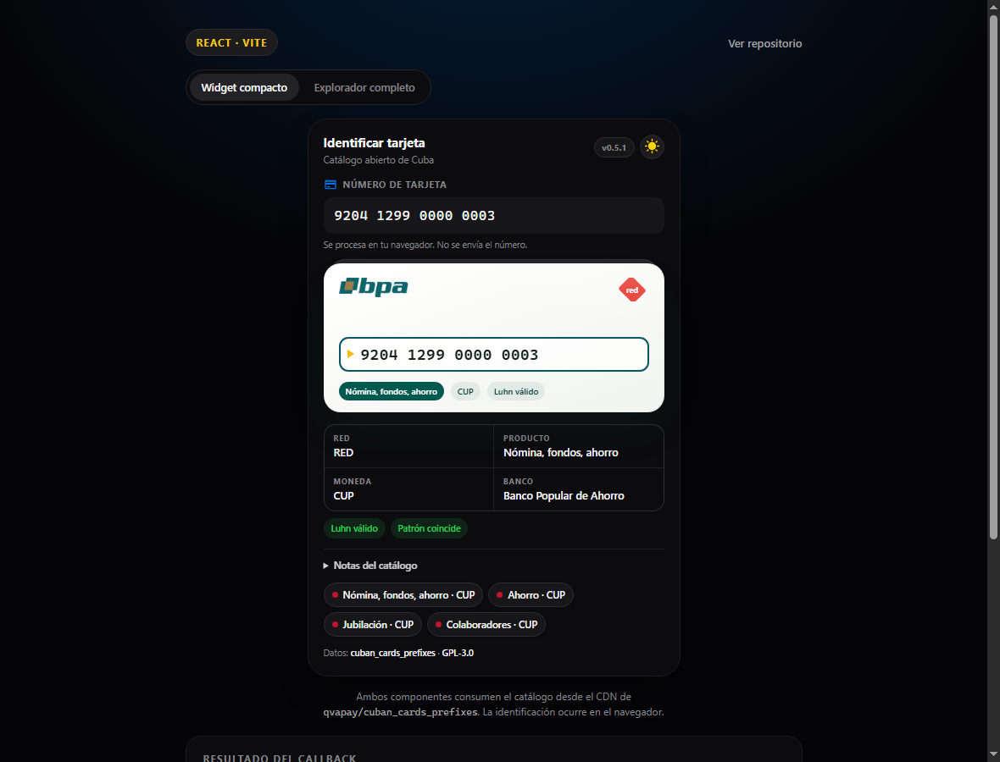
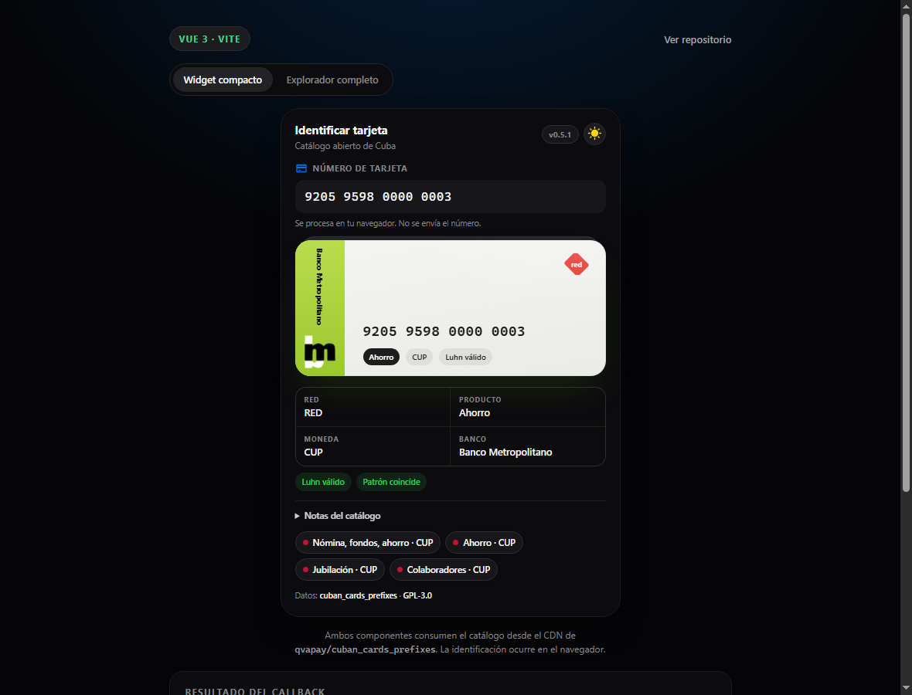
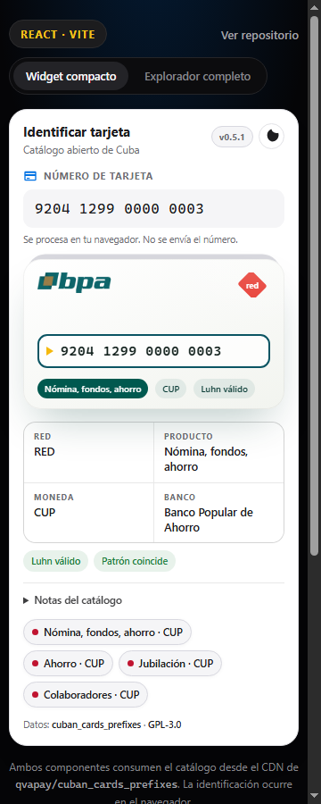

# Cuban Cards Components

[](https://github.com/Chichimokers/cuban-cards-components/actions/workflows/ci.yml)
[](https://www.npmjs.com/package/cuban-cards-react)
[](https://www.npmjs.com/package/cuban-cards-vue)

Componentes **React** y **Vue 3** para identificar tarjetas cubanas y dibujarlas con el estilo del [Explorador de tarjetas cubanas](https://github.com/rblez/explorador-tarjetas-cubanas). El catálogo se consume siempre desde el CDN de [`qvapay/cuban_cards_prefixes`](https://github.com/qvapay/cuban_cards_prefixes), nunca desde una copia local.

Los paquetes incluyen tres niveles de integración:

| Componente | Uso |
| --- | --- |
| `CubanCard` | **Widget compacto y discreto**: input, tarjeta visual y resumen. Es la opción recomendada para incrustar. |
| `CubanCardView` | Solo la tarjeta visual. Acepta un número o un `analysis` ya calculado. |
| `CubanCardExplorer` | Explorador completo: hero, tarjeta, input, anatomía del número, filas de detalle, ejemplos y notas. |

También se exportan `CardVisual` y `DetailSummary` para composiciones propias.





> Los números de las capturas son ejemplos ficticios generados con el catálogo; no corresponden a tarjetas reales.



## Características

- Catálogo remoto con **jsDelivr** como fuente principal y **raw.githubusercontent.com** como respaldo.
- Identificación de red (`RED` / `AIS`), producto, moneda, respaldo MLC, banco y variantes del catálogo.
- Validación **Luhn**, longitud y patrón del catálogo.
- Tarjeta visual con los estilos de BANDEC, BPA, Banco Metropolitano, FINCIMEX/Clásica y Tropical.
- Tema oscuro por defecto, con cambio a claro y opción `auto` siguiendo al sistema. La preferencia se guarda en `localStorage`.
- Avisos de datos incompletos con un enlace que abre un issue en `qvapay/cuban_cards_prefixes`. El issue solo incluye los **8 primeros dígitos**.
- Sin telemetría: el número se procesa en el navegador y no se envía a ningún servidor.
- CSS y assets incluidos en los paquetes; no requiere Tailwind ni otra librería de estilos.
- React 18/19 y Vue 3.

## Privacidad

El componente nunca envía el número completo a un servidor. El análisis, la validación y el dibujo de la tarjeta ocurren en el navegador. Cuando el usuario decide reportar un dato, el enlace de GitHub solo contiene:

- el prefijo de 4 dígitos,
- los 8 primeros dígitos con un espacio,
- metadatos del catálogo (producto, moneda, banco).

El resto del número no se incluye en la URL ni en el issue.

## Instalación

El repositorio es un monorepo con npm workspaces:

```bash
npm install
npm run dev:react   # demo React
npm run dev:vue     # demo Vue
npm run check       # compila paquetes y ejemplos
```

Estructura:

```text
packages/
  core/             lógica, catálogo, análisis, estilos compartidos y assets
  react/            cuban-cards-react
  vue/              cuban-cards-vue
examples/
  react/            demo Vite
  vue/              demo Vite
```

Los paquetes están publicados por separado en npm:

- [`cuban-cards-react`](https://www.npmjs.com/package/cuban-cards-react)
- [`cuban-cards-vue`](https://www.npmjs.com/package/cuban-cards-vue)

Ambos están disponibles en la versión `0.1.0`. Dentro del monorepo se consumen mediante los workspaces y los ejemplos los resuelven con alias de Vite.

## React

```bash
npm install cuban-cards-react
```

```jsx
import { CubanCard } from 'cuban-cards-react'
import 'cuban-cards-react/style.css'

export default function App() {
  return (
    <CubanCard
      onResult={(analysis) => {
        // analysis.n contiene solo los dígitos normalizados
        console.log(analysis.prefix, analysis.network, analysis.banks)
      }}
    />
  )
}
```

Para Next.js, el componente usa hooks de cliente: colócalo en un archivo con `'use client'` o impórtalo desde un componente cliente.

### `CubanCard` (React)

| Prop | Tipo | Default | Descripción |
| --- | --- | --- | --- |
| `cdnBase` | `string` | jsDelivr | URL base alternativa del catálogo. |
| `fallbackBase` | `string` | raw GitHub | Respaldo si falla la fuente principal. |
| `defaultValue` | `string` | `''` | Número inicial. |
| `theme` | `'dark' \| 'light' \| 'auto'` | `'dark'` | Tema visual. |
| `showThemeToggle` | `boolean` | `true` | Muestra el botón de tema. |
| `showDetails` | `boolean` | `true` | Muestra el resumen de red, producto, moneda y banco. |
| `showExamples` | `boolean` | `false` | Muestra ejemplos del catálogo. |
| `showBranding` | `boolean` | `false` | Muestra los enlaces de datos y licencia. |
| `inputId` | `string` | autogenerado | `id` del input. |
| `className` | `string` | `''` | Clase adicional para el contenedor. |
| `style` | `CSSProperties` | — | Estilos del contenedor. |
| `onChange` | `(formatted, digits) => void` | — | Cambios del input. |
| `onResult` | `(analysis) => void` | — | Resultado del análisis. |

### `CubanCardView` (React)

| Prop | Tipo | Default | Descripción |
| --- | --- | --- | --- |
| `number` | `string` | `''` | Número a analizar si no se pasa `analysis`. |
| `analysis` | `object` | — | Resultado ya calculado; evita volver a cargar el catálogo. |
| `size` | `'compact' \| 'default'` | `'compact'` | Tamaño de la tarjeta. |
| `showDetails` | `boolean` | `false` | Muestra el resumen compacto. |
| `theme` | `'dark' \| 'light' \| 'auto'` | `'dark'` | Tema visual. |
| `onResult` | `(analysis) => void` | — | Resultado del análisis. |

### `CubanCardExplorer` (React)

Acepta las mismas props que `CubanCard`, con `showExamples` y `showBranding` activados por defecto. Está pensado para una página completa, no para un widget embebido.

## Vue 3

```bash
npm install cuban-cards-vue
```

```vue
<script setup>
import { CubanCard } from 'cuban-cards-vue'
import 'cuban-cards-vue/style.css'
</script>

<template>
  <CubanCard
    v-model="number"
    @result="onResult"
  />
</template>
```

### `CubanCard` (Vue)

| Prop | Tipo | Default | Descripción |
| --- | --- | --- | --- |
| `modelValue` | `string` | — | Número controlado con `v-model`. |
| `defaultValue` | `string` | `''` | Número inicial si no usas `v-model`. |
| `cdnBase` | `string` | jsDelivr | URL base alternativa del catálogo. |
| `fallbackBase` | `string` | raw GitHub | Respaldo si falla la fuente principal. |
| `theme` | `'dark' \| 'light' \| 'auto'` | `'dark'` | Tema visual. |
| `showThemeToggle` | `boolean` | `true` | Muestra el botón de tema. |
| `showDetails` | `boolean` | `true` | Muestra el resumen compacto. |
| `showExamples` | `boolean` | `false` | Muestra ejemplos del catálogo. |
| `showBranding` | `boolean` | `false` | Muestra los enlaces de datos y licencia. |
| `inputId` | `string` | autogenerado | `id` del input. |
| `style` | `string \| object \| array` | — | Estilos del contenedor. |

Eventos:

- `update:modelValue(formatted)`
- `change(formatted, digits)`
- `result(analysis)`

### `CubanCardView` (Vue)

Props: `number`, `analysis`, `cdnBase`, `fallbackBase`, `theme`, `size`, `showDetails`, `showBranding`, `style`. Emite `result`.

### `CubanCardExplorer` (Vue)

Acepta las mismas props que `CubanCard`, con `showExamples` y `showBranding` activados por defecto.

## Catálogo y CDN

Por defecto:

```text
https://cdn.jsdelivr.net/gh/qvapay/cuban_cards_prefixes@main/
```

Si jsDelivr falla, se intenta:

```text
https://raw.githubusercontent.com/qvapay/cuban_cards_prefixes/main/
```

Puedes cambiar las URLs con `cdnBase` y `fallbackBase`. El catálogo se cachea en memoria durante la vida de la página; varias instancias comparten la misma carga.

Para desarrollo local, los ejemplos aceptan:

```bash
VITE_CUBAN_CARDS_CDN=http://127.0.0.1:5181/
```

El servidor debe responder `prefixes.json` y `validators.json` con CORS habilitado.

## Temas y CSS

El CSS de la librería se importa explícitamente:

```js
import 'cuban-cards-react/style.css'
// o
import 'cuban-cards-vue/style.css'
```

Variables principales disponibles en el contenedor `.ccc-root`:

```css
.ccc-root {
  --ccc-a1: #0071e3;
  --ccc-a2: #42a5f5;
  --ccc-ink: #f5f5f7;
  --ccc-mut: #86868b;
  --ccc-panel: #0c0c0e;
  --ccc-panel-border: #1d1d20;
}
```

El tema se controla con `data-theme="dark|light"` en `.ccc-root`. La preferencia manual se guarda con la clave `cuban-cards-components-theme`.

## Desarrollo

Requisitos: Node.js 20.19+ o 22.12+ (Vite 8).

```bash
npm install
npm run build
npm run build:examples
npm run check
```

- `npm run dev:react` y `npm run dev:vue` levantan las demos.
- `npm run preview:react` y `npm run preview:vue` sirven las demos compiladas.
- El workflow de CI ejecuta `npm ci` y `npm run check` en Node 22.

## Atribución

- Catálogo: [`qvapay/cuban_cards_prefixes`](https://github.com/qvapay/cuban_cards_prefixes), MIT.
- Estilo, estructura visual y assets de referencia: [`rblez/explorador-tarjetas-cubanas`](https://github.com/rblez/explorador-tarjetas-cubanas), MIT, Copyright (c) 2026 Ray Omar Blez.

Los avisos completos están en [NOTICE.md](NOTICE.md). Las marcas y logotipos de los bancos pertenecen a sus titulares y se usan únicamente para identificar visualmente las tarjetas.

## Licencia

El código de este repositorio se distribuye bajo **GNU General Public License v3.0 o posterior** (`GPL-3.0-or-later`). Consulta [LICENSE](LICENSE).

Este proyecto no está afiliado a los bancos cubanos, a QvaPay ni al Explorador de tarjetas cubanas. La identificación es heurística y puede contener datos incompletos; verifica siempre con la entidad emisora.
